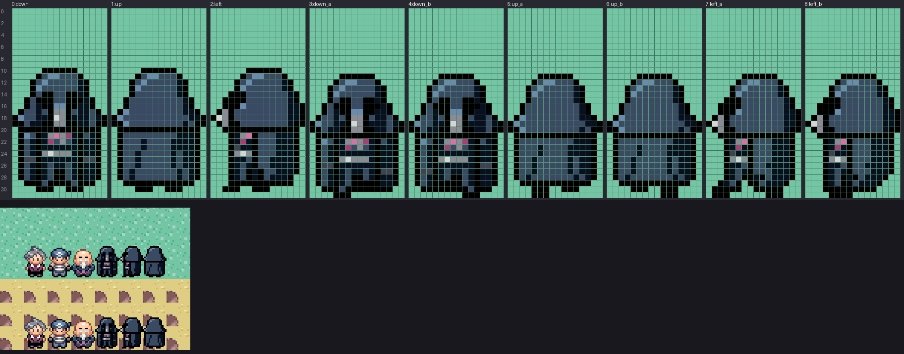

# emerald-art-pipeline-prototype

Tools for drawing every piece of Star Wars replacement art for the pokeemerald fork
(`spencerlepine/pokeemerald`) with an LLM, so that each image drops into the game unchanged.
Each art category has its own standalone tool in `tools/`: its own Python package,
requirements, guide, corpus, art sources and builds. Tools share no code (D16).



## Start here (agents)

1. Read `docs/DECISIONS.md` (why the pipeline is shaped this way) and
   `docs/EMERALD-ART-REQUIREMENTS.md` (what the game accepts).
2. Find the asset's category in **[CHECKLIST.md](CHECKLIST.md)**. It lists every category of
   art in the game, the tool that draws it, and that tool's status.
3. `cd tools/<tool>` and follow its `README.md`. Only tools marked **READY** may be used at
   scale; **PENDING** tools have a researched design waiting on an outside dependency;
   **IN-REVIEW** tools are still being iterated with the owner; **TODO-NEED-TO-BUILD** tools
   don't exist yet.
4. The per-file mapping (which vanilla file becomes which Star Wars character) is in
   `emerald-sw-db/database/pending_art.csv`.

| I need to draw... | Category | Tool | Status |
| --- | --- | --- | --- |
| An overworld walker (16x32 person) | B3 | [tools/sprite-walker-generator](tools/sprite-walker-generator/README.md) | READY |
| A trainer battle pic (64x64 front) | B1, B4 | [tools/sprite-trainer-generator](tools/sprite-trainer-generator/README.md) | READY |
| A player battle back pic (throw sheet) | B2 | [tools/sprite-trainer-back-generator](tools/sprite-trainer-back-generator/README.md) | TODO-NEED-TO-BUILD |
| A creature battle sprite (front, 2nd frame, back, shiny) | A1, A2 | [tools/sprite-creature-generator](tools/sprite-creature-generator/README.md) | PENDING (image model, needs a GPU) |
| Anything else | see [CHECKLIST.md](CHECKLIST.md) | - | TODO-NEED-TO-BUILD |

## Layout

| Path | What |
| --- | --- |
| `CHECKLIST.md` | Master list: every asset category, its tool, status, remaining work (tables generated) |
| `docs/` | Repo-wide decision log and the game's format requirements |
| `tools/<tool>/` | One standalone tool: `README.md`, `requirements.txt`, Python package, `corpus/`, `art/<name>.yaml` (sources the LLM writes), `output/<name>/` (game-ready files, `lint.txt`, `metrics.json`, `preview/`) |
| `tools/asset-checklist/` | The audit: `catalog/categories.yaml` -> the tables in `CHECKLIST.md` |

## Setup

```bash
# pokeemerald next to this repo: corpus, repaint bases, previews, gbagfx, audit
git clone https://github.com/spencerlepine/pokeemerald ../pokeemerald
cd tools/<tool> && pip install -r requirements.txt
```

`EMERALD_DIR` overrides the pokeemerald path (default `../pokeemerald`, using its `game/`
folder when it has one). Regenerate the checklist with
`cd tools/asset-checklist && python -m asset_checklist --write`.

## Workflow with the owner

The owner reviews and approves in chat; the repo is the checkpoint. For each tool: build it,
draw 2-4 mockup variants of a Star Wars character, show the `showcase.png`/`compare` sheet,
iterate, record the pick and the reason in `docs/DECISIONS.md`, then mark the tool READY in
`tools/asset-checklist/catalog/categories.yaml` and regenerate the checklist.
