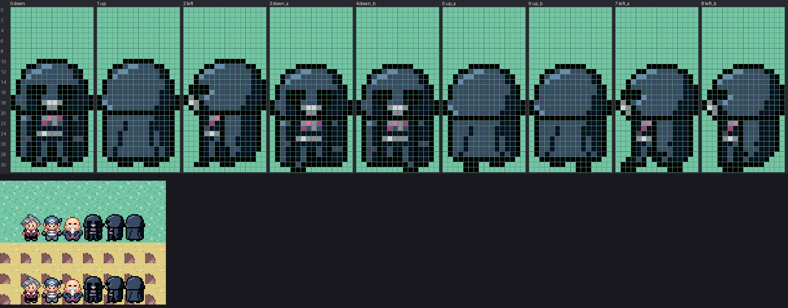

# emerald-art-pipeline-prototype

Prototype pipeline for drawing the Star Wars replacement art of the pokeemerald fork with an
LLM. The LLM writes a sprite as a grid of palette indices; `emerald_sprite` turns it into the
exact indexed PNG pokeemerald builds from, lints it against measured Emerald style, and renders
previews to iterate on.



## Quick start

```bash
pip install -r requirements.txt            # pillow, pyyaml
git clone https://github.com/spencerlepine/pokeemerald ../pokeemerald   # optional: corpus, scene, gbagfx
cd tools
python -m emerald_sprite build   ../sprites/people/vader.yaml   # PNG + previews + lint
python -m emerald_sprite verify  ../sprites/people/vader.yaml   # round-trip through gbagfx
python -m emerald_sprite install ../sprites/people/vader.yaml   # copy into ../pokeemerald
python -m emerald_sprite lint    ../../pokeemerald/graphics/object_events/pics/people/steven.png
python -m emerald_sprite corpus                                 # re-measure vanilla walkers
```

`EMERALD_DIR` overrides the pokeemerald path.

## Layout

| Path | What |
| --- | --- |
| `sprites/<category>/<name>.yaml` | Sprite sources (what the LLM writes) |
| `output/<name>/` | Game-ready PNG, `lint.txt`, `metrics.json`, `preview/` (zoom, walk.gif, scene, showcase) |
| `palettes/` | Copies of Emerald's NPC palettes |
| `corpus/people16x32.json` | Style metrics measured on the 90 vanilla walkers |
| `tools/emerald_sprite/` | The tool |
| `output-analysis/` | Requirements and decisions: read before changing anything |

See `CLAUDE.md` for the procedure to draw a new walker.
